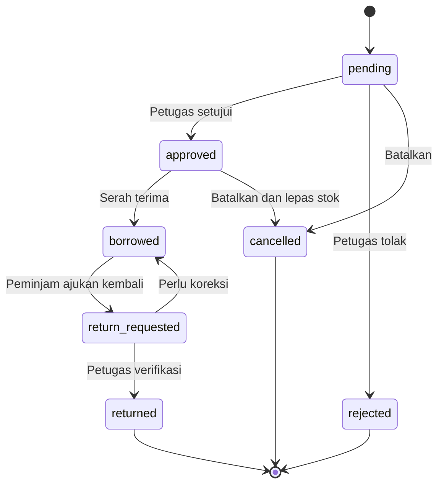
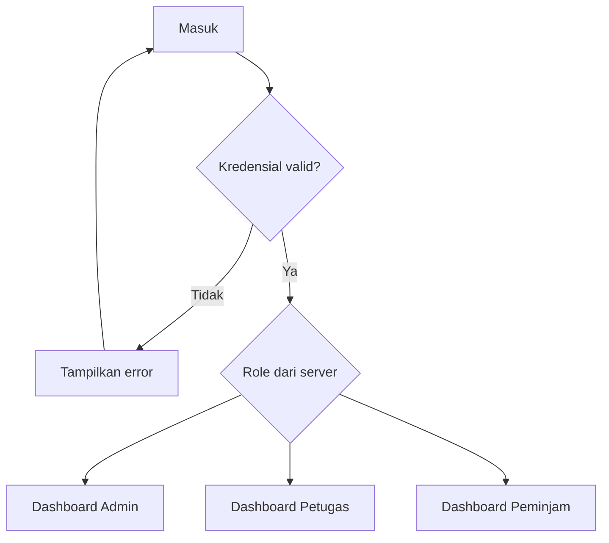
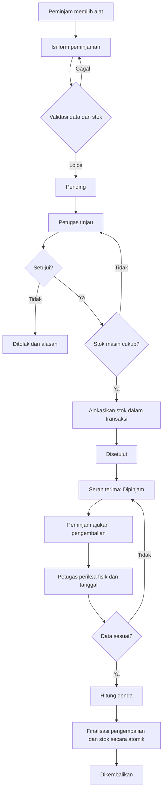
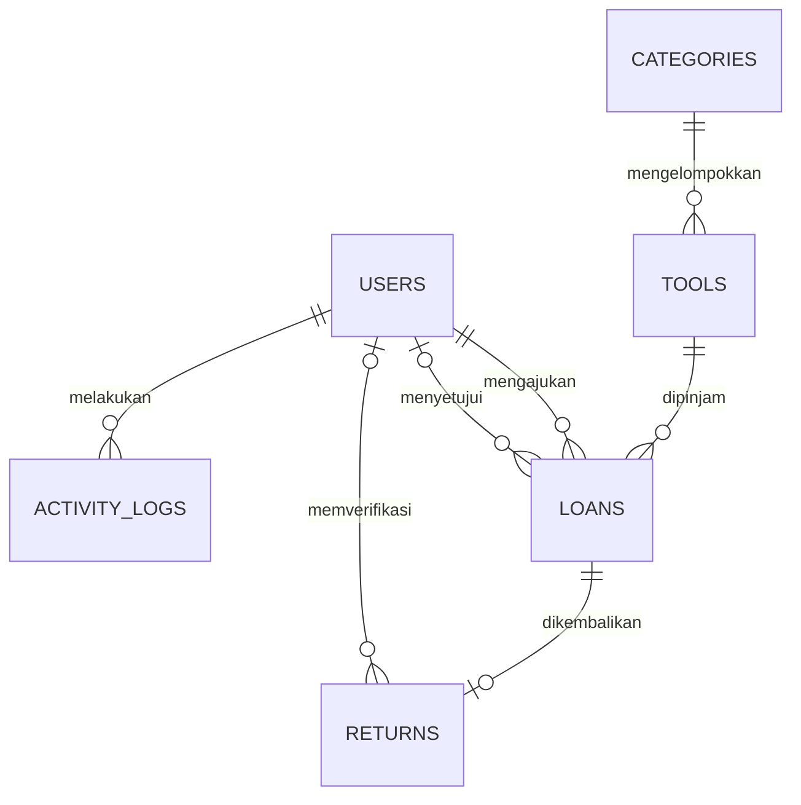

# SPARTA — Design System & UI/UX Specification

> **SPARTA** — Sistem Peminjaman Barang & Alat  
> Versi: 1.1 · Status: Rancangan · Bahasa antarmuka: Indonesia  
> Konteks: UKK RPL Paket 1, tahun pelajaran 2025/2026 (KM25.4.1.1).

## 1. Tujuan dokumen

Dokumen ini menjadi sumber acuan desain untuk OpenCode dan Figcraft melalui Model Context Protocol (MCP), serta implementasi antarmuka web SPARTA. Gunakan dokumen ini sebelum membuat frame, komponen, prototipe atau kode UI. Desain harus mendukung pengelolaan inventaris, pengajuan pinjaman, persetujuan, pengembalian, denda, dan pelaporan secara mudah, konsisten, dan sesuai hak akses.

**Stack implementasi (wajib):**

| Layer | Teknologi | Tanggung jawab |
|---|---|---|
| Frontend | HTML5 | Struktur semantik halaman dan form |
| Frontend | Tailwind CSS + daisyUI | Utility CSS, komponen UI dan tema SPARTA |
| Frontend | JavaScript vanilla | Interaksi, validasi UX, dialog dan filter |
| Backend | PHP native | Routing sederhana, session, RBAC, validasi, logika bisnis dan rendering HTML |
| DBMS | MariaDB | Penyimpanan relasional, transaksi dan integritas data |
| Design tools | OpenCode + Figcraft MCP | Pembuatan dan review desain UI/UX |

Jangan mengganti stack atau menambahkan framework tanpa persetujuan. Tidak menggunakan React, Vue, Bootstrap, Laravel atau framework backend lainnya. Node.js/npm boleh digunakan hanya sebagai tooling build CSS, bukan runtime backend. PHP native menggunakan PDO dengan driver MySQL untuk MariaDB. Versi Tailwind CSS dan daisyUI harus kompatibel dan mengikuti versi yang terpasang; jika proyek baru, usulan baseline adalah Tailwind CSS 4 + daisyUI 5. Jangan mengubah versi dependensi proyek yang sudah ada tanpa persetujuan.

**Sumber kebutuhan:** SPK Paket 1 halaman 2–4 (fitur, alur, pengujian dan keluaran); PPsp Paket 1 halaman 1–3 (elemen kompetensi). Identitas visual, dimensi, aturan bisnis rinci dan keputusan UX berikut adalah usulan desain, bukan ketentuan eksplisit soal.

## 2. Instruksi desain untuk agen

- Prioritaskan fitur wajib UKK sebelum fitur tambahan.
- Gunakan satu design system untuk semua role; bedakan menu, data dan aksi berdasarkan izin.
- Buat antarmuka operasional yang ringkas: hierarki jelas, tabel mudah dipindai, status eksplisit, aksi utama terlihat.
- Gunakan light theme sebagai default, tanpa gradient dekoratif, glassmorphism, animasi berlebihan atau ilustrasi yang mengganggu pekerjaan.
- Jangan membuat data palsu terlihat seperti data produksi. Data contoh harus konsisten dan diberi label demo bila dipakai dalam prototipe.
- Semua form, tombol, status, filter dan navigasi dalam rancangan harus memiliki perilaku yang terdefinisi. Jangan menambahkan fitur tanpa dukungan backend atau menandainya sebagai selesai sebelum diuji.
- Jangan memakai hasil desain sebagai bukti bahwa implementasi atau pengujian sudah selesai.

## 3. Role dan matriks akses

Matriks berikut mengikuti tabel fitur SPK halaman 2. Tanda ✓ menunjukkan fitur wajib; — berarti tidak diberikan sebagai izin umum.

| Fitur | Admin | Petugas | Peminjam |
|---|---|---|---|
| Login / Logout | ✓ | ✓ | ✓ |
| CRUD user | ✓ | — | — |
| CRUD alat | ✓ | — | — |
| CRUD kategori | ✓ | — | — |
| CRUD data peminjaman | ✓ | — | — |
| CRUD pengembalian | ✓ | — | — |
| Log aktivitas | ✓ | — | — |
| Menyetujui peminjaman | — | ✓ | — |
| Memantau pengembalian | — | ✓ | — |
| Mencetak laporan | — | ✓ | — |
| Melihat daftar alat | — | — | ✓ |
| Mengajukan peminjaman | — | — | ✓ |
| Mengembalikan alat | — | — | ✓ |

**Interpretasi desain:** dashboard per role, riwayat pinjaman milik sendiri, penolakan oleh petugas, serta verifikasi fisik pengembalian oleh petugas ditambahkan untuk menyelesaikan alur secara utuh. Admin melihat data alat melalui CRUD; petugas melihat informasi alat dalam transaksi terkait, bukan mengelola master alat. Admin dapat melakukan koreksi administratif dengan audit, tetapi persetujuan operasional tetap milik petugas. Peminjam tidak boleh membaca transaksi pengguna lain. Validasi role dan kepemilikan wajib dilakukan pada server, bukan hanya menyembunyikan menu.

## 4. Identitas visual

**Brand personality:** tegas, rapi, efisien, terpercaya.  
**Tagline usulan:** Kelola alat, pinjam lebih mudah.  
**Logo:** Menggunakan logo resmi SMK Negeri 1 Leuwimunding (`public/assets/img/SMK Negeri 1 Leuwimunding.svg`) dengan rasio dimensi asli 1153:1364 tanpa distorsi, pemotongan, atau recolor, dipadukan dengan wordmark SPARTA ("Sistem Peminjaman Barang & Alat"). Siapkan varian header aplikasi dan login (desktop & mobile). Hindari motif militer yang mendominasi antarmuka.

### 4.1 Color tokens

| Token | HEX | Penggunaan |
|---|---|---|
| brand-50 | `#EEF2FF` | Latar menu aktif |
| brand-600 | `#4F46E5` | CTA utama, link |
| brand-700 | `#4338CA` | Hover CTA |
| brand-900 | `#312E81` | Aksen identitas |
| canvas | `#F8FAFC` | Latar aplikasi |
| surface | `#FFFFFF` | Card, panel, tabel |
| text-primary | `#0F172A` | Judul dan teks utama |
| text-secondary | `#475569` | Deskripsi |
| text-muted | `#64748B` | Metadata |
| border | `#E2E8F0` | Divider dan batas card |
| input-border | `#94A3B8` | Batas input |
| success-bg / fg | `#DCFCE7` / `#166534` | Berhasil, tersedia, selesai |
| warning-bg / fg | `#FEF3C7` / `#92400E` | Menunggu, perhatian |
| danger-bg / fg | `#FEE2E2` / `#991B1B` | Ditolak, terlambat, error |
| info-bg / fg | `#DBEAFE` / `#1E40AF` | Dipinjam, informasi |
| neutral-bg / fg | `#F1F5F9` / `#475569` | Nonaktif, dibatalkan |

Warna tidak boleh menjadi satu-satunya pembeda status. Gunakan label teks dan ikon bila diperlukan. Target kontras WCAG AA: 4.5:1 teks normal, 3:1 teks besar dan indikator UI relevan. Verifikasi kontras saat finalisasi.

### 4.2 Typography

Font utama: Inter; fallback: system-ui, sans-serif. Self-host jika memungkinkan agar aplikasi tetap berjalan tanpa koneksi internet. Gunakan angka tabular pada jumlah stok, tanggal dan nominal denda.

| Style | Ukuran / line height | Weight |
|---|---|---|
| Display/login | 32 / 40 px | 700 |
| Page title | 28 / 36 px | 700 |
| Section title | 20 / 28 px | 600 |
| Card title | 16 / 24 px | 600 |
| Body | 14 / 22 px | 400 |
| Label | 14 / 20 px | 500 |
| Caption | 12 / 18 px | 400 |
| KPI value | 30 / 38 px | 700 |

### 4.3 Spacing, radius, elevation

- Spacing grid: 4 px; token 4, 8, 12, 16, 20, 24, 32, 40, 48, 64 px.
- Radius: 6 px input/button, 12 px card, 16 px modal, 999 px status pill.
- Card: border 1 px; shadow minimal `0 1px 2px rgb(15 23 42 / 0.06)`.
- Modal: `0 20px 40px rgb(15 23 42 / 0.16)`; overlay gelap 40%.
- Ikon: Seluruh UI wajib menggunakan ikon resmi Lucide (disimpan lokal di `public/assets/icons/lucide/`, tanpa CDN atau dependensi npm runtime baru); 20 px navigasi sidebar, 16 px inline/tombol/kontrol, disertai label teks aksesibel pada implementasi semantik. Gunakan satu set ikon secara konsisten.

## 5. Layout dan responsivitas

| Frame | Layout | Padding konten |
|---|---|---|
| Desktop 1440 × 1024 | Sidebar 248 px, topbar 64 px, main fluid | 32 px |
| Laptop 1280 × 800 | Sidebar 232–248 px, main fluid | 24 px |
| Tablet 768 × 1024 | Sidebar drawer, topbar 64 px | 24 px |
| Mobile 390 × 844 | Drawer menu, topbar 56 px, konten 1 kolom | 16 px |

Breakpoint implementasi: mobile default; `md` ≥ 768 px; `lg` ≥ 1024 px; `xl` ≥ 1280 px. Desktop sidebar tetap terlihat; mobile sidebar menjadi drawer dengan overlay dan fokus terkelola. Dashboard menggunakan grid 4/2/1 kolom sesuai ruang. Katalog menggunakan 3–4/2/1 kolom. Tabel pada mobile menggunakan scroll horizontal yang terbatas pada kontainer atau card list dengan field penting dan aksi tetap tersedia. Jangan membuat seluruh halaman overflow horizontal.

### 5.1 App shell

- Sidebar: logo, kelompok navigasi, item aktif, identitas role, tombol keluar di bagian bawah.
- Topbar: breadcrumb pada desktop, judul konteks, menu profil. Mobile menampilkan hamburger dan judul ringkas.
- Main: judul halaman + deskripsi + satu aksi primer; filter; isi; pagination.
- Footer opsional: `SPARTA · Sistem Peminjaman Barang & Alat`.
- Tidak perlu global search atau ikon notifikasi jika belum ada fungsi nyata.

## 6. Sitemap

```text
SPARTA
├── Login
├── Admin
│   ├── Dashboard
│   ├── Pengguna (daftar, tambah, edit, detail)
│   ├── Kategori (daftar, tambah, edit)
│   ├── Alat (daftar, tambah, edit, detail)
│   ├── Peminjaman (daftar, tambah, edit, detail)
│   ├── Pengembalian (daftar, tambah, edit, detail)
│   └── Log Aktivitas
├── Petugas
│   ├── Dashboard
│   ├── Persetujuan Peminjaman (daftar, detail)
│   ├── Pengembalian (monitoring, detail, verifikasi)
│   └── Laporan (filter, preview, cetak)
└── Peminjam
    ├── Dashboard
    ├── Katalog Alat (daftar, detail)
    ├── Ajukan Peminjaman
    ├── Peminjaman Saya (daftar, detail)
    └── Ajukan Pengembalian (dari detail pinjaman)
```

Rute usulan: `/login.php`, `/admin/dashboard.php`, `/admin/alat/index.php`, `/petugas/peminjaman/index.php`, `/peminjam/alat/index.php`, dan pola serupa. Navigasi mengikuti struktur proyek nyata; jangan mengasumsikan rute sudah dibuat.

## 7. Komponen reusable

| Komponen | Variants / states | Aturan |
|---|---|---|
| Button | primary, secondary, ghost, danger; default, hover, focus, disabled, loading | Tinggi 40–44 px; label berupa kata kerja; ikon opsional |
| Input / Select / Textarea | default, focus, error, disabled, readonly | Label di atas, pesan error di bawah, helper text bila perlu |
| Search | default, filled, loading | Placeholder spesifik; tombol clear bila terisi |
| Sidebar item | default, hover, active, focus | Ikon + label; menu aktif memiliki penanda visual |
| KPI card | angka, label, ikon, link opsional | Jangan tampilkan tren tanpa data pembanding |
| Status badge | pending, approved, borrowed, return-requested, returned, rejected, cancelled, overdue | Teks status wajib; lihat bagian 8 |
| Data table | default, loading, empty, error | Header jelas, aksi per baris, pagination server-side |
| Item card | available, unavailable, maintenance | Foto, kode, nama, kategori, stok, aksi detail |
| Modal | confirmation, destructive, form pendek | Fokus awal, Escape, focus trap, restore focus; tombol batal |
| Toast / inline alert | success, error, warning, info | Error penting juga tampil inline; tidak hilang sebelum dapat dibaca |
| Pagination | first, previous, next, last | Default 10 atau 15 baris; total hasil dan halaman aktif |
| Empty state | no data, no results | Pesan kontekstual dan tindakan lanjut yang relevan |
| Skeleton | card, table, detail | Ukuran mendekati isi akhir; jangan mengganti error dengan loading terus-menerus |
| Image placeholder | missing / failed | Ikon kotak inventaris; alt text yang sesuai |

Nama komponen desain: `Button/Primary`, `Input/Text`, `Badge/LoanStatus`, `Table/Inventory`, `Card/Tool`, `Navigation/Sidebar`, `Dialog/Confirm`, `Feedback/Empty`, `Feedback/Toast`.

## 8. Status dan aturan bisnis

### 8.1 Status peminjaman

| Key | Label UI | Warna | Makna |
|---|---|---|---|
| pending | Menunggu Persetujuan | warning | Pengajuan belum diproses |
| approved | Disetujui | success | Stok sudah dialokasikan, menunggu serah terima |
| borrowed | Dipinjam | info | Alat sudah diserahkan |
| return_requested | Pengembalian Diajukan | warning | Peminjam meminta pengembalian |
| returned | Dikembalikan | success | Pengembalian selesai diverifikasi |
| rejected | Ditolak | danger | Petugas menolak pengajuan |
| cancelled | Dibatalkan | neutral | Transaksi dibatalkan sesuai aturan |
| overdue (derived) | Terlambat | danger | Pinjaman belum selesai dan melewati jatuh tempo |

`overdue` merupakan indikator turunan, bukan status yang menimpa status transaksi. Pada pengembalian yang telah diajukan tetapi belum diverifikasi, tampilkan tanggal pengajuan dan status keterlambatan secara jelas; denda final mengacu tanggal serah terima kembali yang dicatat petugas.



### 8.2 Aturan stok, tanggal dan denda (usulan)

- Satu transaksi MVP memuat satu jenis alat dan jumlah unit. Peminjaman beberapa jenis dapat dibuat sebagai transaksi terpisah; keranjang multi-item bukan prioritas UKK.
- Jumlah harus bilangan bulat positif dan tidak melebihi stok tersedia. Pengajuan pending belum mengurangi stok; persetujuan mengalokasikan stok secara atomik. Jika stok berubah, petugas mendapat pesan konflik dan pengajuan tetap pending.
- Serah terima tidak mengurangi stok kedua kali. Pembatalan approved melepas alokasi. Pengembalian final menambah stok layak pakai; unit rusak masuk stok perawatan/karantina, bukan tersedia.
- Stok total = tersedia + dialokasikan/dipinjam + perawatan. Gunakan transaksi database, locking yang sesuai dan validasi ulang pada server. Hindari stok negatif dan duplikasi pengembalian.
- Tanggal rencana pinjam tidak boleh sebelum hari ini saat pengajuan; jatuh tempo tidak boleh sebelum tanggal pinjam. Tanggal aktual dicatat pada serah terima.
- Denda usulan: Rp5.000 per hari terlambat per transaksi (bukan per unit); dapat dikonfigurasi. `hari_terlambat = max(0, selisih hari kalender tanggal kembali aktual dan jatuh tempo)`; `denda = hari_terlambat × tarif_harian`. Simpan tarif yang berlaku pada transaksi agar historis stabil. Zona waktu Asia/Jakarta.
- Contoh: jatuh tempo 12 November, kembali 14 November → 2 hari × Rp5.000 = Rp10.000. Denda ditampilkan sebagai estimasi sampai verifikasi selesai. Pembayaran online tidak termasuk MVP.
- Kondisi barang: Baik, Rusak ringan, Rusak berat. Kondisi dan catatan wajib diperiksa petugas saat pengembalian. Jika jumlah lebih dari satu, catat jumlah layak pakai dan rusak; total harus sama dengan jumlah dipinjam. MVP menggunakan pengembalian penuh, bukan parsial.
- Hapus master hanya jika tidak memiliki referensi transaksi; jika sudah dipakai, nonaktifkan. Penghapusan/koreksi transaksi harus mengikuti aturan status, audit dan rekonsiliasi stok; jangan menghapus histori transaksi selesai secara fisik. Tombol CRUD admin harus menjelaskan pembatasan ini.

## 9. Spesifikasi halaman

### 9.1 Login — semua role

Layout desktop: card form 420 px pada tengah layar atau split layout sederhana (area brand + form). Mobile: satu kolom. Isi: logo sekolah resmi, judul `Masuk ke SPARTA`, deskripsi, Email (label `Email`, NISN/NIP dihapus sesuai arahan), password dengan toggle tampil/sembunyi, tombol `Masuk`. Tidak perlu pendaftaran publik, pemilih role, atau lupa password palsu. Role ditentukan server setelah autentikasi.

State: input kosong, password tersembunyi, loading, kredensial salah (`Email atau kata sandi tidak sesuai.`), akun nonaktif, sukses → dashboard role. Gunakan pesan generik untuk kredensial salah. Logout mengakhiri sesi; tampilkan kembali halaman login. Logo sekolah pada antarmuka mobile ditampilkan tunggal pada header/topbar web (tidak ganda di dalam kartu).

### 9.2 Admin — Dashboard

KPI: Total alat (jenis aktif), Total pengguna aktif, Peminjaman aktif (borrowed + return_requested), Menunggu persetujuan (pending). Bagian utama: tabel transaksi terbaru dengan kode, nama peminjam, alat, tanggal, status dan aksi detail. Panel ringkas stok rendah berdasarkan ambang konfigurasi (usulan ≤ 3 unit) dan tautan ke alat. Quick action: `Tambah Alat`. Semua KPI menggunakan query sesuai definisi dan periode yang ditampilkan.

### 9.3 Admin — Pengguna

Tabel: nama, username, role, status akun, tanggal dibuat, aksi. Filter role dan status; pencarian nama/username. Form: nama lengkap, username unik, password (wajib saat tambah, opsional saat edit), role, status aktif. Password tidak pernah muncul pada tabel atau detail. Tombol: `Tambah Pengguna`, `Simpan`, `Batal`, `Nonaktifkan`/`Hapus` sesuai referensi. Cegah admin menghapus/menonaktifkan akun sendiri atau admin aktif terakhir.

### 9.4 Admin — Kategori

Tabel: kode kategori, nama, deskripsi, jumlah alat, aksi. Form: kode unik, nama kategori unik, deskripsi opsional. Contoh: Elektronik, Perkakas, Multimedia. Hapus hanya jika tidak direferensikan alat; jika tidak, tampilkan alasan dan pilihan nonaktifkan bila didukung data.

### 9.5 Admin — Alat

Header `Data Alat`, CTA `Tambah Alat`. Filter kategori, kondisi, ketersediaan; pencarian nama/kode. Tabel: foto thumbnail, kode, nama, kategori, stok total, tersedia, kondisi, aksi. Detail memperlihatkan foto, deskripsi, lokasi penyimpanan, stok tersedia/dialokasikan/perawatan.

Form: kode alat unik, nama, kategori, deskripsi, lokasi, stok total (saat tambah), kondisi awal, foto opsional (JPG/PNG/WebP, usulan maksimal 2 MB). Pada edit, perubahan stok harus melalui penyesuaian yang mempertimbangkan unit sedang dipinjam; stok tersedia tidak boleh diubah langsung tanpa rekonsiliasi. Preview foto dan pesan validasi upload tersedia. Tombol `Simpan Alat`, `Batal`.

### 9.6 Admin — Peminjaman dan Pengembalian

Daftar peminjaman: kode, peminjam, alat, jumlah, tanggal pinjam, jatuh tempo, status, aksi. Filter status/periode/pencarian. Detail menampilkan data transaksi, timeline, catatan dan riwayat koreksi. CRUD admin memakai aturan status; tambah transaksi membuat pending untuk peminjam yang dipilih. Edit jumlah hanya sebelum persetujuan atau melalui prosedur koreksi yang mengembalikan alokasi. Jangan menyediakan tombol persetujuan petugas pada menu admin.

Daftar pengembalian: kode, kode pinjaman, peminjam, alat, tanggal aktual, kondisi, denda, status, aksi. Form admin dapat membuat/mengoreksi catatan pengembalian untuk transaksi yang valid dengan alasan koreksi. Catatan final tidak boleh menghasilkan pengembalian stok dua kali. Detail menampilkan rincian denda dan audit. Hapus dibatasi catatan draft/belum final; catatan final menggunakan koreksi berjejak.

### 9.7 Admin — Log Aktivitas

Tabel: waktu, pengguna, role, aksi, entitas, ID referensi, ringkasan. Filter periode, role dan aksi. Detail opsional: perubahan sebelum/sesudah yang sudah disanitasi. Log bersifat read-only di UI; tidak menyimpan password, token sesi atau rahasia. Contoh: `Petugas menyetujui PJ-0001`.

### 9.8 Petugas — Dashboard

KPI: Menunggu persetujuan, Siap diserahkan (approved), Sedang dipinjam (borrowed + return_requested), Terlambat (indikator turunan). Tabel antrean persetujuan dan pengembalian jatuh tempo. CTA `Lihat Pengajuan`. Fokus pada pekerjaan yang harus ditindaklanjuti, bukan master data.

### 9.9 Petugas — Persetujuan Peminjaman

Daftar default pending; filter status, periode, pencarian. Kolom: kode, peminjam, alat, jumlah, tanggal, stok tersedia, status, aksi `Tinjau`. Detail: profil ringkas peminjam, informasi alat, tujuan peminjaman, stok terkini, periode, catatan. Aksi `Setujui` dan `Tolak` untuk pending; penolakan wajib alasan. Modal persetujuan menampilkan jumlah dan dampak stok. Setelah approved, aksi `Konfirmasi Serah Terima` mengubah status menjadi borrowed dan menyimpan tanggal aktual. Semua aksi bersifat idempoten secara bisnis.

### 9.10 Petugas — Monitoring Pengembalian

Tabs atau filter: Sedang Dipinjam, Terlambat, Pengembalian Diajukan, Selesai. Tabel: kode, peminjam, alat, jatuh tempo, hari terlambat, status, aksi. Detail pengembalian berisi tanggal pengajuan, tanggal kembali aktual, jumlah unit baik/rusak, kondisi, catatan, perhitungan denda. Aksi `Verifikasi Pengembalian` untuk return_requested; `Minta Koreksi` dengan alasan bila belum sesuai. Tampilkan konfirmasi dampak stok dan denda sebelum finalisasi.

### 9.11 Petugas — Laporan

Judul `Laporan Peminjaman`. Filter tanggal mulai/akhir, status, kategori. Definisi periode default berdasarkan tanggal pengajuan; label harus eksplisit. Ringkasan jumlah transaksi, selesai, aktif, total denda final untuk hasil terfilter. Tabel laporan mencantumkan kode, peminjam, alat, jumlah, tanggal pinjam/kembali, status, denda. Tombol `Terapkan Filter`, `Reset`, `Cetak Laporan`.

Print layout A4 landscape bila tabel lebar; logo, judul, periode, tanggal cetak, tabel dan total. Sembunyikan sidebar, topbar, filter dan aksi melalui print CSS. Cetak semua hasil terfilter sesuai izin, bukan hanya halaman pagination aktif. Browser print/PDF cukup untuk MVP; ekspor CSV opsional sebagai bukti akses file bila diimplementasikan secara aman.

### 9.12 Peminjam — Dashboard

Sapaan nama pengguna, CTA `Cari Alat`. KPI pribadi: Menunggu Persetujuan, Sedang Dipinjam, Selesai, Terlambat. Panel pinjaman yang perlu dikembalikan (kode, alat, jatuh tempo, status, CTA detail). Tidak menampilkan statistik atau data peminjam lain.

### 9.13 Peminjam — Katalog dan Detail Alat

Grid card dengan gambar 4:3, nama, kode, kategori, stok tersedia, badge dan `Lihat Detail`. Filter kategori/ketersediaan dan pencarian. Detail: foto, nama, kode, deskripsi, kondisi, lokasi, stok, tombol `Ajukan Peminjaman`. Jika tidak tersedia, tombol disabled dengan alasan jelas. Stok ditampilkan sebagai jumlah unit, bukan sekadar label tersedia.

### 9.14 Peminjam — Ajukan Peminjaman

Form dengan ringkasan alat terpilih, jumlah, tanggal rencana pinjam, jatuh tempo, tujuan, catatan opsional. Identitas peminjam berasal dari sesi, bukan field user ID yang dapat diubah. Tampilkan stok terkini, informasi kebijakan denda, validasi per field. CTA `Ajukan Peminjaman`, secondary `Batal`. Sukses menuju detail dengan status Menunggu Persetujuan. Konflik stok atau validasi server tidak menghapus isian.

### 9.15 Peminjam — Peminjaman Saya dan Pengembalian

Daftar transaksi milik pengguna sendiri; filter status dan pencarian kode/nama alat. Detail: kode, alat, jumlah, tanggal, status, timeline, alasan penolakan bila ada, estimasi denda, catatan petugas yang relevan. Aksi `Batalkan Pengajuan` hanya saat pending (usulan); `Ajukan Pengembalian` saat borrowed. Form pengembalian: ringkasan pinjaman, tanggal pengajuan (otomatis), kondisi yang dilaporkan, catatan, estimasi denda. CTA `Ajukan Pengembalian`. Setelah terkirim, tampilkan pesan menunggu verifikasi; stok tidak bertambah sebelum petugas menyelesaikan proses.

## 10. Wireframe struktur

```text
DESKTOP — ADMIN DASHBOARD
┌─────────────────┬────────────────────────────────────────────┐
│ SPARTA          │ Dashboard                       Profil ▾  │
│                 ├────────────────────────────────────────────┤
│ Dashboard       │ Ringkasan inventaris       [+ Tambah Alat] │
│ Pengguna        │                                            │
│ Kategori        │ [Alat] [Pengguna] [Aktif] [Menunggu]        │
│ Alat            │                                            │
│ Peminjaman      │ Transaksi Terbaru              Lihat semua │
│ Pengembalian    │ ┌────────────────────────────────────────┐ │
│ Log Aktivitas   │ │ Kode | Peminjam | Alat | Status | Aksi │ │
│                 │ │ ...                                    │ │
│                 │ └────────────────────────────────────────┘ │
│ Keluar          │ Stok Rendah                                │
└─────────────────┴────────────────────────────────────────────┘

MOBILE — KATALOG PEMINJAM
┌──────────────────────────┐
│ ☰  Katalog Alat     Profil│
│ Cari alat...             │
│ [Kategori] [Tersedia]    │
│ ┌──────────────────────┐ │
│ │       Foto alat      │ │
│ │ Bor listrik          │ │
│ │ Perkakas · ALT-001    │ │
│ │ Tersedia: 5 unit      │ │
│ │ [Lihat Detail]       │ │
│ └──────────────────────┘ │
│ ...                      │
└──────────────────────────┘
```

## 11. User flow utama





## 12. Data model konseptual untuk UI

Nama tabel usulan; sesuaikan dengan skema implementasi. Ini bukan pengganti ERD fisik, migrasi atau file SQL.



| Entitas | Field utama yang ditampilkan/digunakan |
|---|---|
| users | id, nama, username, password_hash, role, is_active |
| categories | id, kode, nama, deskripsi, is_active |
| tools | id, category_id, kode, nama, deskripsi, lokasi, foto_path, stok_total, stok_tersedia, stok_perawatan, kondisi, is_active |
| loans | id, kode, user_id, tool_id, qty, tanggal_pengajuan, rencana_pinjam, tanggal_pinjam_aktual, jatuh_tempo, tujuan, status, approved_by, tarif_denda, alasan, timestamps |
| returns | id, loan_id (unik), tanggal_pengajuan, tanggal_kembali_aktual, qty_baik, qty_rusak, kondisi, catatan, hari_terlambat, denda, status_verifikasi, verified_by |
| activity_logs | id, user_id, aksi, entitas, entitas_id, ringkasan, created_at |

Rancang unique constraint untuk username, kode alat, kode transaksi, dan satu return per loan; foreign key untuk relasi; index pada status, tanggal, dan FK yang sering difilter. Gunakan DECIMAL/integer rupiah untuk nominal, bukan floating-point. Stok dialokasikan dapat dihitung dari transaksi approved/borrowed/return_requested. Pengembalian final memperbarui stok dan status bersama-sama.

Rencana bukti kompetensi SQL: JOIN laporan; stored procedure alokasi/finalisasi sesuai transaksi; function hitung denda; trigger audit perubahan status (hindari duplikasi log dengan PHP); demonstrasi COMMIT dan ROLLBACK. Tetapkan satu pemilik batas transaksi (PHP atau procedure) agar tidak terjadi commit parsial. Desain UI tidak menggantikan implementasi SQL tersebut.

## 13. Microcopy dan feedback

| Situasi | Pesan UI |
|---|---|
| Login gagal | Username atau kata sandi tidak sesuai. |
| Alat tersimpan | Data alat berhasil disimpan. |
| Kode duplikat | Kode alat sudah digunakan. Gunakan kode lain. |
| Stok kurang | Stok tersedia tidak mencukupi. Periksa jumlah terbaru. |
| Pengajuan berhasil | Pengajuan berhasil dikirim. Tunggu persetujuan petugas. |
| Pengembalian diajukan | Pengembalian diajukan. Petugas akan memeriksa kondisi alat. |
| Pengembalian selesai | Pengembalian berhasil diverifikasi. |
| Akses ditolak | Anda tidak memiliki izin untuk mengakses halaman ini. |
| Tidak ada hasil | Tidak ada data yang sesuai dengan filter Anda. |
| Error server | Data belum dapat diproses. Silakan coba lagi. |

Format lokal: `16 Nov 2026`, `Rp10.000`, `5 unit`. Hindari istilah internal seperti CRUD, foreign key, stack trace dan SQL error pada UI pengguna. Gunakan `Kata sandi`, `Peminjaman`, `Pengembalian`, `Alat`, `Pengguna` secara konsisten.

## 14. Accessibility dan keamanan UX

- HTML semantik, label form terkait input, heading berurutan, tabel menggunakan th/caption bila sesuai.
- Semua aksi dapat digunakan via keyboard. Focus ring terlihat 2 px, kontras memadai; jangan hapus outline tanpa pengganti.
- Target interaksi mobile disarankan 44 × 44 px. Modal mengelola fokus dan memiliki nama aksesibel.
- Error field terhubung lewat `aria-describedby`; feedback dinamis menggunakan live region yang tepat.
- Jangan mengandalkan warna, tooltip atau hover saja untuk informasi penting.
- PHP: `password_hash` / `password_verify`, regenerasi session ID saat login, role guard, CSRF token pada mutasi, PDO prepared statements, escaping output HTML, validasi server.
- Foto: validasi MIME, ukuran, nama file acak, larang eksekusi script pada direktori upload. Jangan mempercayai ekstensi file saja.
- Aksi mutasi menggunakan POST; double submit dicegah pada UI dan server. Error teknis dicatat server, bukan ditampilkan ke pengguna.
- Pagination dan filter server-side; query efisien, hindari N+1, limit dataset dan optimalkan thumbnail. Uji target waktu muat pada lingkungan UKK; jangan mengklaim performa tanpa pengukuran.

## 15. Workflow OpenCode + Figcraft MCP

### 15.1 Prasyarat dan discovery

1. Letakkan `DESIGN.md` di root repository SPARTA.
2. Pastikan OpenCode dapat membaca proyek dan MCP server Figcraft terpasang/terhubung dengan izin yang diperlukan.
3. Periksa daftar tools MCP yang benar-benar tersedia, schema argumen, kemampuan membaca/membuat/mengubah desain, dan target dokumen/file. Jangan mengarang tool name, endpoint, konfigurasi, token atau ID frame.
4. Jika Figcraft tidak tersedia atau tidak mendukung suatu operasi, catat keterbatasannya; buat spesifikasi/wireframe dalam Markdown dan jangan mengklaim desain telah disinkronkan.
5. Baca file desain yang sudah ada sebelum melakukan perubahan. Gunakan frame/component existing jika cocok; hindari overwrite destruktif.

### 15.2 Struktur dokumen desain target

```text
SPARTA / UI Design
├── 00 — Foundations (colors, typography, spacing, icons)
├── 01 — Components (variants and states)
├── 02 — Authentication
├── 03 — Admin
├── 04 — Petugas
├── 05 — Peminjam
├── 06 — Responsive (mobile key screens)
└── 07 — Flows & Handoff
```

Jika MCP tidak mendukung pages, gunakan pengelompokan frame dengan prefix yang sama. Gunakan nama frame `Admin/Dashboard/Desktop`, `Petugas/Approval/Detail/Desktop`, `Peminjam/Catalog/Mobile`. Pakai auto layout, reusable components, constraints/resizing, dan variables jika alat mendukung. Bila tidak, dokumentasikan token dan konsistensi secara manual.

### 15.3 Urutan eksekusi agen

| Tahap | Tugas | Output yang diverifikasi |
|---|---|---|
| 1 | Audit requirement, repo, dan tools MCP | Daftar halaman dan kemampuan MCP |
| 2 | Foundations | Token warna, tipografi, spacing, layout |
| 3 | Components | Komponen + variants/states |
| 4 | App shell dan login | Desktop/mobile shell, login states |
| 5 | Admin | Seluruh CRUD, dashboard, log |
| 6 | Petugas | Approval, serah terima, return, report |
| 7 | Peminjam | Katalog, pengajuan, riwayat, return |
| 8 | Responsive + prototype | Frame mobile dan koneksi flow jika didukung |
| 9 | Handoff | Inventaris frame, referensi, token, gap, review |
| 10 | Implementasi | HTML/Tailwind CSS + daisyUI/JS vanilla/PHP native/MariaDB sesuai desain dan skema |

Setelah setiap tahap, gunakan kemampuan read/inspect/render yang tersedia untuk memeriksa hasil aktual. Simpan ID atau link hasil tool hanya jika benar-benar dikembalikan. Jangan membuat duplikat frame saat mengulang tahap. Minta persetujuan sebelum perubahan destruktif atau perubahan scope besar.

### 15.4 Prompt siap pakai untuk OpenCode

```text
Baca DESIGN.md sebagai single source of truth UI/UX SPARTA dan periksa struktur repository.
Gunakan Figcraft melalui MCP yang tersedia di sesi ini. Discover tool dan schema aktual terlebih dahulu.

Tujuan: buat desain web app high-fidelity yang konsisten untuk Admin, Petugas, dan Peminjam sesuai matriks akses UKK.
Mulai dari foundations dan reusable components, kemudian login, app shell, seluruh halaman per role, serta frame mobile untuk alur inti.
Gunakan token, ukuran, nama frame, copy bahasa Indonesia, status transaksi, dan aturan bisnis pada DESIGN.md.
Rancang komponen agar dapat diimplementasikan dengan HTML, Tailwind CSS + daisyUI, JavaScript vanilla dan PHP native dengan MariaDB. Gunakan daisyUI sebagai basis komponen, bukan framework UI tambahan.
Gunakan data demo konsisten. Buat state loading, empty, error, disabled, success dan modal konfirmasi yang relevan.
Jangan menambahkan fitur atau mengubah role tanpa persetujuan. Jangan mengarang tool MCP atau mengklaim hasil yang belum dibuat.
Periksa hasil aktual setelah setiap batch, perbaiki layout yang terpotong, kontras, dan ketidakkonsistenan.
Jika suatu kemampuan MCP tidak tersedia, jelaskan gap dan buat fallback berupa spesifikasi Markdown.

Hasil akhir: daftar frame yang dibuat, referensi/ID yang benar-benar tersedia, komponen, token, coverage fitur, hasil review, serta pekerjaan tersisa.
Jangan implementasikan backend atau mengubah database pada tahap desain kecuali diminta.
```

### 15.5 Handoff ke implementasi

Setelah desain disetujui, gunakan token berikut sebagai basis CSS (sesuaikan integrasi Tailwind dan daisyUI dengan versi yang benar-benar terpasang):

```css
:root {
  --color-brand: #4F46E5;
  --color-brand-hover: #4338CA;
  --color-brand-soft: #EEF2FF;
  --color-canvas: #F8FAFC;
  --color-surface: #FFFFFF;
  --color-text: #0F172A;
  --color-text-secondary: #475569;
  --color-border: #E2E8F0;
  --color-input-border: #94A3B8;
  --radius-control: 6px;
  --radius-card: 12px;
  --sidebar-width: 248px;
  --topbar-height: 64px;
  --font-sans: Inter, system-ui, sans-serif;
}
```

Gunakan partial PHP untuk shell, sidebar, topbar, badge, table, form field dan dialog. Jangan menyalin seluruh halaman untuk tiap role jika komponen dapat digunakan bersama. JavaScript mengurus interaksi UI, bukan otorisasi atau perhitungan final stok/denda. Backend merupakan sumber kebenaran.

### 15.6 Pemetaan komponen daisyUI

| Komponen desain | Kelas dasar daisyUI |
|---|---|
| Button | `btn`, `btn-primary`, `btn-ghost`, `btn-error` |
| Input / Select / Textarea | `input`, `select`, `textarea` |
| Sidebar / mobile drawer | `menu`, `drawer`, `drawer-toggle`, `drawer-side` |
| Topbar | `navbar`, `dropdown`, `avatar` |
| KPI / katalog | `card`, `card-body`, `stats`, `stat` |
| Status | `badge`, `badge-success`, `badge-warning`, `badge-info`, `badge-error` |
| Tabel | `table`, `table-zebra` (opsional), wrapper `overflow-x-auto` |
| Dialog | `modal`, `modal-box`, `modal-action` |
| Feedback | `alert`, `toast`, `loading`, `skeleton` |
| Pagination | `join`, `join-item`, `btn` |

Gunakan utility Tailwind untuk grid, spacing, breakpoint, alignment dan penyesuaian visual. Terapkan tema SPARTA melalui mekanisme tema daisyUI sesuai versi, bukan dengan menimpa setiap komponen secara terpisah. Untuk baseline Tailwind 4 + daisyUI 5, contoh entry CSS:

```css
@import "tailwindcss";
@plugin "daisyui";
@plugin "daisyui/theme" {
  name: "sparta";
  default: true;
  prefersdark: false;
  color-scheme: light;
  --color-base-100: #FFFFFF;
  --color-base-200: #F8FAFC;
  --color-base-300: #E2E8F0;
  --color-base-content: #0F172A;
  --color-primary: #4F46E5;
  --color-primary-content: #FFFFFF;
  --color-secondary: #475569;
  --color-secondary-content: #FFFFFF;
  --color-neutral: #0F172A;
  --color-neutral-content: #FFFFFF;
  --color-info: #1E40AF;
  --color-info-content: #FFFFFF;
  --color-success: #166534;
  --color-success-content: #FFFFFF;
  --color-warning: #92400E;
  --color-warning-content: #FFFFFF;
  --color-error: #991B1B;
  --color-error-content: #FFFFFF;
  --radius-field: 0.375rem;
  --radius-box: 0.75rem;
  --radius-selector: 0.375rem;
}
```

Gunakan `data-theme="sparta"` pada elemen `html`. Pertahankan warna latar badge lembut dari bagian 8 dengan kelas tambahan atau token semantik khusus; jangan mengandalkan warna default badge untuk menggantikan spesifikasi desain. Contoh konfigurasi di atas merupakan baseline usulan, bukan konfigurasi yang sudah diuji pada repository.

### 15.7 Kontrak implementasi frontend/backend

- Build CSS lokal menggunakan Tailwind CLI yang kompatibel; simpan output CSS di `assets/css/app.css` dan muat dari layout PHP. Pastikan file `.php`, `.html`, dan `.js` tercakup dalam source scanning. Hindari kelas Tailwind yang dirangkai dinamis; gunakan mapping kelas lengkap.
- Gunakan HTML semantik dan partial PHP untuk komponen daisyUI. JavaScript vanilla menangani dialog native (`showModal()`), drawer, konfirmasi, serta progressive enhancement; daisyUI tidak menggantikan logika JavaScript.
- PHP native memproses form POST, memvalidasi input, memeriksa role dan CSRF, menjalankan transaksi PDO, lalu redirect dengan flash message (Post/Redirect/Get). GET untuk membaca data dan filter. Jangan menaruh kredensial DB di direktori publik.
- MariaDB menggunakan InnoDB, foreign key, unique constraint dan transaksi untuk perubahan stok/peminjaman. Jangan menggunakan JavaScript sebagai sumber kebenaran stok, denda atau otorisasi.
- Pastikan aplikasi dapat dijalankan tanpa Node.js pada server produksi setelah CSS dibangun. Tidak menggunakan CDN sebagai dependensi wajib saat demo UKK.

## 16. Data demo konsisten

| Kode | Alat | Kategori | Total | Tersedia | Perawatan |
|---|---|---|---:|---:|---:|
| ALT-001 | Bor listrik | Perkakas | 8 | 5 | 1 |
| ALT-002 | Proyektor | Elektronik | 4 | 3 | 0 |
| ALT-003 | Kamera DSLR | Multimedia | 3 | 0 | 1 |
| ALT-004 | Multimeter | Elektronik | 6 | 6 | 0 |

Data demo tanggal acuan 16 Nov 2026; bukan data nyata. Contoh transaksi:

| Kode | Peminjam | Alat | Qty | Jatuh tempo | Status |
|---|---|---|---:|---|---|
| PJ-0001 | Andi Pratama | Bor listrik | 2 | 18 Nov 2026 | Dipinjam |
| PJ-0002 | Siti Rahma | Proyektor | 1 | 15 Nov 2026 | Dipinjam · Terlambat |
| PJ-0003 | Budi Santoso | Kamera DSLR | 2 | 20 Nov 2026 | Disetujui |
| PJ-0004 | Siti Rahma | Multimeter | 1 | 19 Nov 2026 | Menunggu Persetujuan |
| PJ-0005 | Andi Pratama | Bor listrik | 1 | 12 Nov 2026 | Dikembalikan 14 Nov 2026 |

PJ-0005 memiliki denda final Rp10.000 dengan tarif contoh; stok pinjaman ini sudah dipulihkan. PJ-0004 belum mengurangi stok. Gunakan akun demo berbeda untuk tiga role, tanpa password nyata pada desain.

## 17. Acceptance criteria dan pengujian

### 17.1 Checklist UI/UX

- [ ] Semua fitur wajib SPK memiliki halaman/aksi yang dapat ditemukan oleh role berwenang.
- [ ] Login/logout dan redirect role sesuai hak akses.
- [ ] Semua CRUD memiliki validasi, detail, feedback, dan konfirmasi tindakan destruktif.
- [ ] Petugas dapat meninjau, menyetujui/menolak, menyerahkan, memantau, dan memverifikasi pengembalian.
- [ ] Peminjam dapat menemukan alat, mengajukan dan mengembalikan alat serta melihat riwayat sendiri.
- [ ] Denda estimasi/final dibedakan dan formula dapat dijelaskan.
- [ ] Laporan terfilter memiliki preview dan print layout tanpa navigasi.
- [ ] Empty, loading, error, success dan disabled state tersedia pada alur relevan.
- [ ] Desktop 1440 px, laptop 1280 px, tablet 768 px, mobile 390 px diperiksa; tidak ada clipping yang menghilangkan aksi.
- [ ] Keyboard, fokus, label, kontras, dan target sentuh diperiksa.
- [ ] Token dan komponen konsisten; tidak ada ikon atau tombol yang tidak berfungsi.

### 17.2 Test cases minimum UKK + tambahan

Seluruh hasil berikut adalah **expected result**, belum merupakan hasil pengujian aktual.

| ID | Skenario | Expected result |
|---|---|---|
| TC-01 | Login valid tiap role; password salah | Dashboard sesuai role; kredensial salah ditolak dengan pesan |
| TC-02 | Admin tambah alat valid/duplikat | Data valid tersimpan; kode duplikat ditolak |
| TC-03 | Peminjam ajukan alat tersedia | Pending tercatat; stok belum berkurang |
| TC-04 | Ajukan pengembalian dan verifikasi terlambat | Status selesai; stok layak bertambah sekali; denda tepat |
| TC-05 | Peminjam buka URL admin / data orang lain | Server menolak akses tanpa kebocoran data |
| TC-06 | Dua petugas menyetujui stok terakhir | Hanya alokasi yang valid berhasil; stok tidak negatif |
| TC-07 | Pengembalian ganda / refresh POST | Tidak ada penambahan stok atau denda ganda |
| TC-08 | Laporan difilter dan dicetak | Data dan total sesuai filter; print bersih |
| TC-09 | Hapus alat dengan histori | Ditolak atau nonaktif sesuai aturan; histori tetap utuh |
| TC-10 | Upload file tidak valid | Ditolak server; pesan yang dapat dipahami |
| TC-11 | Kegagalan saat finalisasi transaksi | Rollback menjaga stok/status tetap konsisten |

Simpan actual result, status pass/fail, tanggal, data uji, screenshot dan perbaikan dalam dokumentasi pengujian terpisah. Dokumentasikan bug yang belum selesai dengan jujur.

## 18. Keluaran UKK dan batas scope

Dokumen SPK meminta folder proyek lengkap, database `.sql`, ERD, deskripsi program, dokumentasi fungsi/prosedur, debugging, pengujian beserta screenshot, dan laporan evaluasi singkat. PPsp juga menilai struktur data, metode pengembangan, SQL relasional/procedure/function/trigger/transaction, array, akses file, dokumentasi yang dihasilkan, debugging dan pengujian. `DESIGN.md` ini mencakup rancangan awal, bukan seluruh bukti kompetensi.

Struktur dokumentasi usulan:

```text
sparta/
├── DESIGN.md
├── README.md
├── database/
│   └── sparta.sql
├── docs/
│   ├── ERD.md
│   ├── PROGRAM.md
│   ├── modules/       # input, proses, output, fungsi/prosedur/method
│   ├── TESTING.md
│   ├── DEBUGGING.md
│   ├── EVALUATION.md
│   └── screenshots/
└── ... source aplikasi
```

Metode pengembangan usulan: Waterfall sederhana dengan review prototipe pada tahap desain; analisis → desain → implementasi → pengujian → dokumentasi. Prioritas: fitur wajib dan bukti pengujian sebelum dark mode, QR/barcode, notifikasi email, pembayaran digital, multi-gudang atau keranjang multi-item. Fitur tersebut di luar MVP.

## 19. Keputusan yang perlu dikonfirmasi

- Palet indigo/slate dan penggunaan Inter sebagai identitas awal; dapat diganti setelah logo/branding final tersedia.
- Satu jenis alat per transaksi, pengembalian penuh, alokasi saat persetujuan, serta verifikasi fisik oleh petugas adalah keputusan rancangan.
- Tarif denda Rp5.000/hari per transaksi dan ambang stok rendah 3 unit adalah contoh kebijakan, bukan angka resmi soal UKK.
- Mekanisme CRUD administratif pada transaksi final dibatasi demi integritas data; konfirmasi dengan penguji apakah demonstrasi hapus draft cukup untuk kebutuhan penilaian.
- Nama/kemampuan tool Figcraft MCP, lokasi file desain dan konfigurasi aktual belum diverifikasi dalam lingkungan pengguna. Dokumen ini tidak mengklaim frame telah dibuat di Figcraft.

---

**Definition of done desain:** semua frame dan state prioritas dibuat, matriks akses tervalidasi, komponen dan token konsisten, alur utama dapat ditinjau, responsive layout diperiksa, dan handoff tersedia. Implementasi dan pengujian nyata merupakan tahap terpisah.
