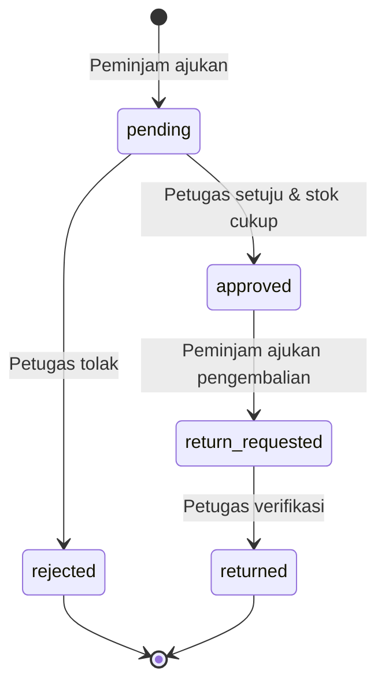
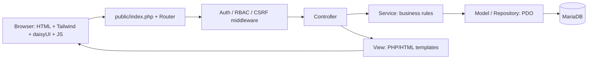
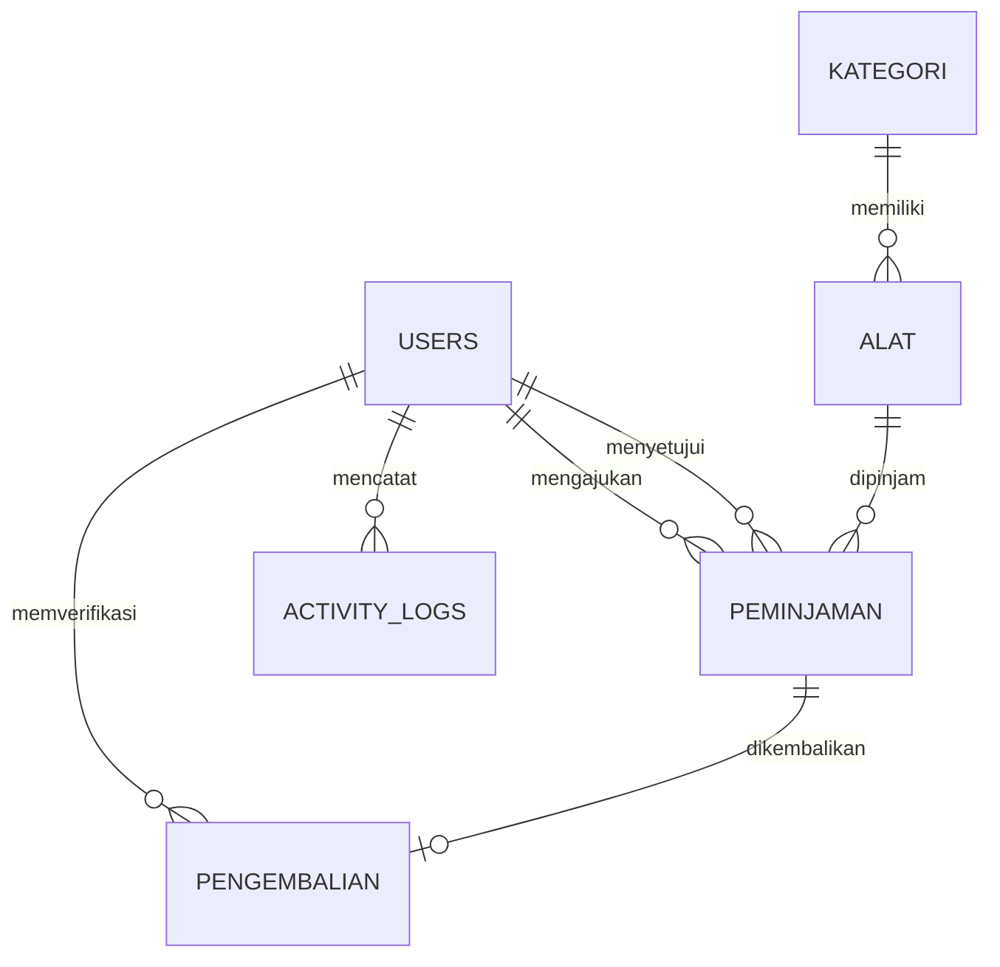

# PRODUCT REQUIREMENTS DOCUMENT (PRD)

# SPARTA — Sistem Peminjaman Barang & Alat

| Metadata | Nilai |
|---|---|
| Nama produk | SPARTA (Sistem Peminjaman Barang & Alat) |
| Nama tugas UKK | Pengembangan Aplikasi Peminjaman Alat |
| Dokumen acuan | UKK RPL Paket 1, Tahun Pelajaran 2025/2026 |
| Kode soal | KM25.4.1.1 |
| Versi PRD | 1.0 |
| Status | Baseline kebutuhan untuk implementasi |
| Frontend | HTML5, CSS, JavaScript Vanilla, Tailwind CSS, daisyUI |
| Backend | PHP Native, pola MVC |
| DBMS | MariaDB |
| Arsitektur | Server-rendered monolith (MVC), progressive enhancement dengan JavaScript |
| Pengguna | Admin, Petugas, Peminjam |

> **Keterangan sumber:** Bagian yang ditandai **[UKK]** merupakan ketentuan yang eksplisit dalam dokumen soal praktik/penilaian. Bagian bertanda **[Rancangan]** adalah keputusan implementasi untuk melengkapi detail yang tidak ditentukan oleh UKK; dapat direvisi tanpa mengubah persyaratan wajib.

## 1. Ringkasan Eksekutif

**[UKK]** Peserta diminta mengembangkan aplikasi peminjaman alat dengan tiga level pengguna: Admin, Petugas, dan Peminjam. Pengembangan meliputi analisis, desain ERD/diagram program, implementasi, pengujian, dan dokumentasi.

**[Rancangan]** SPARTA adalah aplikasi web internal untuk mengelola daftar alat, kategori, pengguna, pengajuan peminjaman, proses persetujuan, pengembalian, audit aktivitas, dan laporan. Aplikasi memakai PHP Native dengan pemisahan **Model–View–Controller (MVC)**, MariaDB untuk penyimpanan relasional, dan HTML + Tailwind CSS + daisyUI + JavaScript Vanilla sebagai antarmuka.

### 1.1 Masalah

Pencatatan alat dan transaksi secara manual berisiko menimbulkan data ganda, ketidakjelasan ketersediaan alat, sulitnya mengetahui siapa yang meminjam, keterlambatan pengembalian, dan laporan yang memerlukan rekap manual. **[Rancangan: formulasi masalah]**

### 1.2 Tujuan produk

1. Memungkinkan peminjam melihat dan mengajukan peminjaman alat.
2. Memungkinkan petugas memutuskan pengajuan, memantau pengembalian, dan mencetak laporan.
3. Memungkinkan admin mengelola seluruh data master dan transaksi serta membaca log aktivitas.
4. Menjamin konsistensi data stok dan rekam transaksi.
5. Memenuhi hasil kerja, pengujian, dan dokumentasi UKK.

### 1.3 Indikator keberhasilan (acceptance gates)

- Seluruh fitur pada matriks UKK berfungsi sesuai role.
- Tidak ada role yang dapat mengakses tindakan di luar hak akses melalui manipulasi URL atau HTTP request.
- Pengajuan, persetujuan, dan pengembalian memperbarui status transaksi dan stok secara konsisten.
- Minimal lima skenario uji wajib UKK terdokumentasi dengan hasil dan screenshot.
- Ekspor database `.sql`, source code lengkap, ERD, dokumentasi, dan laporan evaluasi tersedia.

## 2. Dasar dan Batasan UKK

### 2.1 Dokumen acuan

1. **P1-SPK Rekayasa Perangkat Lunak.pdf**, halaman 2: tabel fitur dan tiga role; halaman 3–4: langkah kerja, pengujian, dan berkas hasil.
2. **P1-PPsp Rekayasa Perangakat Lunak.pdf**, halaman 1–3: rubrik kompetensi pemrograman, SQL, dokumentasi, debugging, dan pengujian.
3. **P1-KAP Rekayasa Perangakat Lunak.pdf**, halaman 2: kisi-kisi pertanyaan mengenai duplikasi data, debugging, hasil eksekusi, dan standar kode.
4. **P1-InV Rekayasa Perangkat Lunak.pdf**, halaman 2–3: spesifikasi lingkungan/peralatan tempat uji.

### 2.2 Alokasi waktu

- **SPK [UKK]:** alokasi praktik **23 jam**.
- **PPsp [UKK]:** lembar penilaian mencantumkan **24 jam**. Dokumen tidak menjelaskan perbedaan ini; untuk penjadwalan praktik gunakan ketentuan penguji/sekolah, dan gunakan rencana MVP di bagian 16 sebagai saran pembagian pekerjaan.

### 2.3 In scope

- Autentikasi login/logout untuk tiga role.
- Seluruh CRUD dan log Admin sebagaimana matriks UKK.
- Persetujuan peminjaman, pemantauan pengembalian, laporan Petugas.
- Katalog alat, pengajuan peminjaman, pengembalian oleh Peminjam.
- Database SQL relasional, stored procedure, function, trigger, commit dan rollback.
- ERD, flowchart/pseudocode tiga proses, dokumentasi modul, debugging, pengujian, screenshot, laporan evaluasi.

### 2.4 Out of scope (MVP) — [Rancangan]

- Pembayaran denda online dan payment gateway.
- Notifikasi email, WhatsApp, SMS, atau push.
- Aplikasi Android/iOS native.
- Integrasi barcode/QR, SSO, perangkat IoT, dan sistem akuntansi.
- Reservasi multi-cabang dan manajemen procurement.
- Registrasi publik tanpa proses admin.

Fitur opsional di luar cakupan utama baru dikerjakan apabila semua syarat UKK telah terpenuhi.

## 3. Persona dan Hak Akses (RBAC)

### 3.1 Definisi role

- **Admin:** pengelola master data, data transaksi, dan audit aktivitas.
- **Petugas:** pemeriksa pengajuan, pemantau pengembalian, dan penyusun laporan.
- **Peminjam:** pengguna yang mengakses katalog, membuat pengajuan, dan memproses pengembalian miliknya.

### 3.2 Matriks fitur wajib — [UKK]

| Kode | Fitur | Admin | Petugas | Peminjam |
|---|---|:---:|:---:|:---:|
| FR-01 | Login | ✓ | ✓ | ✓ |
| FR-02 | Logout | ✓ | ✓ | ✓ |
| FR-03 | CRUD user | ✓ | — | — |
| FR-04 | CRUD alat | ✓ | — | — |
| FR-05 | CRUD kategori | ✓ | — | — |
| FR-06 | CRUD data peminjaman | ✓ | — | — |
| FR-07 | CRUD pengembalian | ✓ | — | — |
| FR-08 | Log aktivitas | ✓ | — | — |
| FR-09 | Menyetujui peminjaman | — | ✓ | — |
| FR-10 | Memantau pengembalian | — | ✓ | — |
| FR-11 | Mencetak laporan | — | ✓ | — |
| FR-12 | Melihat daftar alat | — | — | ✓ |
| FR-13 | Mengajukan peminjaman | — | — | ✓ |
| FR-14 | Mengembalikan alat | — | — | ✓ |

**Catatan:** Matriks di atas mempertahankan pembagian fitur eksplisit dari soal. Halaman dashboard untuk setiap role merupakan **[Rancangan]** (navigasi/ringkasan), bukan penambahan wewenang lintas-role. Admin dapat mengakses data transaksi melalui CRUD tetapi tidak secara otomatis diberi tindakan khusus “menyetujui” yang dalam soal dialokasikan kepada Petugas.

### 3.3 Kebijakan RBAC — [Rancangan]

- Semua route selain login memerlukan session aktif.
- Role diperiksa **di server**, bukan sekadar menyembunyikan menu.
- Peminjam hanya dapat melihat dan memodifikasi transaksi miliknya yang diizinkan oleh status.
- Admin dapat mengelola data master dan transaksi sesuai batasan integritas data.
- Petugas boleh mengubah status pengajuan lewat aksi persetujuan serta melihat transaksi terkait pengembalian dan laporan; tidak diberi akses CRUD master.
- Seluruh aksi penolakan akses menghasilkan HTTP 403, dan tidak mengungkap data sensitif.

## 4. User Journey dan Alur Proses

### 4.1 Login — [UKK: flowchart/pseudocode wajib; detail rancangan]

1. Pengguna membuka halaman login.
2. Mengisi username dan password.
3. Server memvalidasi format input dan membaca akun aktif melalui Model.
4. Password diverifikasi menggunakan `password_verify()`.
5. Jika benar: regenerate session ID, set identitas+role, catat aktivitas, redirect ke dashboard role.
6. Jika salah: tampilkan pesan generik; jangan membuat session login.
7. Logout menghapus session dan mengarahkan ke login.

### 4.2 Pengajuan dan persetujuan peminjaman

1. Peminjam membuka katalog dan memilih alat yang tersedia.
2. Peminjam mengisi jumlah, tanggal rencana pinjam/kembali, dan tujuan.
3. Server memvalidasi kepemilikan akun, tanggal, stok, dan jumlah.
4. Sistem membuat transaksi berstatus **`pending`**; stok belum dikurangi (keputusan rancangan).
5. Petugas membuka antrean dan memilih **Setujui** atau **Tolak**.
6. Saat setuju, server mengunci baris stok alat, memeriksa kembali ketersediaan, mencatat persetujuan, lalu mengurangi stok tersedia dalam satu transaksi DB.
7. Saat tolak, status menjadi **`rejected`** dan stok tidak berubah.
8. Peminjam dapat melihat status pengajuan miliknya.

### 4.3 Pengembalian dan denda

1. Peminjam memilih transaksi aktif miliknya dan mengajukan pengembalian.
2. Sistem mencatat waktu pengajuan pengembalian dan status **`return_requested`**.
3. Petugas memantau dan memeriksa pengembalian fisik; **konfirmasi penerimaan** petugas adalah keputusan rancangan tambahan agar stok tidak kembali sebelum barang benar-benar diterima.
4. Petugas memverifikasi kuantitas/kondisi, tanggal diterima, dan nominal denda bila aturan denda diaktifkan.
5. Dalam satu transaksi database, sistem mencatat pengembalian, menandai peminjaman **`returned`**, dan mengembalikan stok tersedia.
6. Aktivitas perubahan status dicatat dalam log.

**Denda:** Soal mewajibkan deskripsi alur pengembalian dan perhitungan denda, tetapi pada skenario uji menyebut denda **opsional**. Untuk dapat memperagakan perhitungan, **[Rancangan]** gunakan `denda = hari_terlambat × tarif_denda_per_hari × jumlah`, dengan `hari_terlambat = max(0, selisih tanggal aktual dan jatuh tempo dalam hari kalender)`. Tarif bawaan **Rp0** sampai penguji/pemilik produk menentukan tarif; hindari mengklaim nominal tertentu ditetapkan UKK. Laporan dan UI harus tetap berfungsi saat denda Rp0.

### 4.4 State transition — [Rancangan]



- Status **terlambat** dihitung berdasarkan tanggal jatuh tempo dan status aktif; bukan transisi wajib tersendiri.
- Penghapusan transaksi yang sudah disetujui atau dikembalikan tidak boleh menyebabkan inkonsistensi stok; gunakan soft-delete/pembatalan yang diaudit bila diperlukan.
- Tidak ada status `approved` jika pengurangan stok gagal.

## 5. Kebutuhan Fungsional Rinci

Untuk setiap requirement di bawah, kriteria penerimaan adalah perilaku minimal yang dapat diuji. Detail di luar tabel UKK ditandai sebagai rancangan.

### FR-01 & FR-02 — Login dan logout

- **Aktor:** Semua role.
- **Input:** Username, password.
- **Proses:** Autentikasi dan sesi aman; validasi akun aktif.
- **Output:** Redirect dashboard atau error; logout mengakhiri session.
- **AC:** Kredensial benar berhasil; salah ditolak; setelah logout URL privat tidak dapat diakses lagi tanpa login.

### FR-03 — CRUD pengguna (Admin)

- **Input:** Nama, username, password awal, role, status akun.
- **Proses:** Buat, daftar/detail, ubah, nonaktifkan/hapus sesuai integritas referensial.
- **Output:** Daftar akun dan notifikasi hasil.
- **AC:** Username unik; password di-hash; non-admin HTTP 403; akun yang direferensikan transaksi tidak dihapus secara destruktif (**[Rancangan]**).

### FR-04 — CRUD alat (Admin)

- **Input:** Kode alat, nama, kategori, deskripsi, stok total, status (opsional foto).
- **Proses:** Validasi kode unik dan kuantitas non-negatif; CRUD terpaginasikan.
- **Output:** Daftar/detail alat.
- **AC:** Duplikasi kode ditolak; stok total tidak boleh kurang dari jumlah unit sedang dipinjam; daftar terlihat sesuai role.

### FR-05 — CRUD kategori (Admin)

- **Input:** Nama/kode kategori, deskripsi.
- **Proses:** Tambah, lihat, ubah, hapus kategori.
- **Output:** Daftar kategori.
- **AC:** Kategori yang sedang digunakan alat tidak boleh dihapus tanpa penanganan referensi; input duplikat ditolak menurut aturan unik.

### FR-06 — CRUD data peminjaman (Admin)

- **Input:** Peminjam, alat, jumlah, tanggal, status, catatan.
- **Proses:** Lihat/buat/koreksi/hapus sesuai state machine dan integritas stok.
- **Output:** Daftar transaksi dan detail histori.
- **AC:** Perubahan data tidak menimbulkan stok negatif atau persetujuan tanpa tindakan Petugas. Koreksi transaksi aktif harus menjaga audit trail.

### FR-07 — CRUD pengembalian (Admin)

- **Input:** Referensi peminjaman, tanggal, jumlah dikembalikan, kondisi, denda (jika ada).
- **Proses:** Rekam/edit/hapus administratif dengan kontrol integritas.
- **Output:** Data pengembalian.
- **AC:** Tidak dapat mengembalikan lebih banyak daripada jumlah yang dipinjam; modifikasi administratif menjaga konsistensi stok dan audit.

### FR-08 — Log aktivitas (Admin)

- **Input:** Event dari aksi login/logout dan perubahan data utama.
- **Proses:** Simpan actor, aksi, entitas, ID entitas, waktu, ringkasan perubahan yang aman.
- **Output:** Tabel aktivitas terurut terbaru dengan filter/paginasi.
- **AC:** Admin dapat menelusuri event; role lain tidak dapat mengakses; log tidak mencatat password atau token.

### FR-09 — Menyetujui peminjaman (Petugas)

- **Input:** ID pengajuan, keputusan setuju/tolak, catatan.
- **Proses:** Verifikasi status `pending`, cek stok terkini; simpan status dan petugas pengambil keputusan.
- **Output:** Status pengajuan dan notifikasi.
- **AC:** Permintaan tidak dapat disetujui dua kali; stok tidak negatif saat dua petugas menyetujui bersamaan; penolakan tidak mengurangi stok.

### FR-10 — Memantau pengembalian (Petugas)

- **Input:** Filter status, tanggal jatuh tempo, peminjam.
- **Proses:** Menampilkan transaksi aktif, jatuh tempo, terlambat, dan permintaan pengembalian.
- **Output:** Monitoring/daftar pengembalian.
- **AC:** Status jatuh tempo tepat; Petugas hanya bisa melakukan tindakan operasional pengembalian yang dibutuhkan oleh workflow.

### FR-11 — Mencetak laporan (Petugas)

- **Input:** Rentang tanggal dan status.
- **Proses:** Query rekap transaksi sesuai filter, render halaman cetak HTML dengan print stylesheet.
- **Output:** Laporan yang dapat dicetak browser / disimpan sebagai PDF melalui dialog browser.
- **AC:** Hasil sesuai filter dan angka database; tersedia judul, tanggal cetak, tabel, dan ringkasan. Pembuatan file PDF server-side bukan syarat UKK.

### FR-12 — Melihat daftar alat (Peminjam)

- **Input:** Kata kunci, kategori, urutan, halaman.
- **Proses:** Cari alat yang aktif, hitung stok tersedia.
- **Output:** Katalog dengan nama, kategori, dan ketersediaan.
- **AC:** Peminjam tidak melihat menu CRUD; pencarian dan pagination bekerja.

### FR-13 — Mengajukan peminjaman (Peminjam)

- **Input:** Alat, jumlah, tanggal awal, jatuh tempo, tujuan.
- **Proses:** Buat transaksi `pending` dengan peminjam dari session, bukan dari parameter user bebas.
- **Output:** Nomor pengajuan dan status.
- **AC:** Jumlah positif; tanggal valid; tidak dapat mengajukan atas nama orang lain; pengajuan tersimpan untuk ditinjau Petugas.

### FR-14 — Mengembalikan alat (Peminjam)

- **Input:** Transaksi aktif miliknya dan pengajuan pengembalian.
- **Proses:** Ubah alur menjadi menunggu verifikasi penerimaan fisik.
- **Output:** Bukti/status pengajuan pengembalian.
- **AC:** Hanya transaksi sendiri yang dapat diajukan kembali; transaksi yang sudah `returned` tidak dapat dikembalikan ulang.

## 6. Kebutuhan Nonfungsional — [Rancangan]

| ID | Aspek | Ketentuan minimum dan bukti |
|---|---|---|
| NFR-01 | Keamanan autentikasi | `password_hash()`/`password_verify()`, sesi HttpOnly, session regenerate saat login |
| NFR-02 | Otorisasi | Middleware RBAC + pemeriksaan kepemilikan resource di Controller/Service |
| NFR-03 | SQL injection | PDO prepared statements, tidak menyusun SQL dari input mentah |
| NFR-04 | XSS | Escape output HTML `htmlspecialchars()`; sanitasi sesuai konteks |
| NFR-05 | CSRF | Token CSRF wajib untuk request perubahan data |
| NFR-06 | Validasi | Semua input divalidasi server-side meskipun ada validasi JS |
| NFR-07 | Performa | Query terindeks, `LIMIT`/pagination, menghindari N+1/loop tak perlu; sesuai penekanan UKK |
| NFR-08 | Integritas | Foreign key, unique constraint, transaksi DB, locking stok, rollback saat gagal |
| NFR-09 | Usability | Responsive desktop/mobile, label/error jelas, fokus keyboard dan kontras layak |
| NFR-10 | Maintainability | Folder MVC, controller ringkas, business rules di Service, konvensi nama konsisten |
| NFR-11 | Observability | Log error server; audit perubahan kritis tanpa mencatat rahasia |
| NFR-12 | Portabilitas | Berjalan pada PHP + MariaDB yang tersedia di lingkungan uji; konfigurasi melalui `.env` atau config yang tidak di-commit |

## 7. Keputusan Teknologi & Arsitektur MVC — [Rancangan]

### 7.1 Stack

- HTML5 untuk markup semantik.
- CSS + Tailwind CSS untuk utility dan responsive layout.
- daisyUI sebagai komponen/tokens antarmuka.
- JavaScript Vanilla untuk interaksi, validasi UX, filter/debounce opsional, dan modal; semua operasi bisnis tetap divalidasi PHP.
- PHP Native tanpa Laravel/CodeIgniter/Symfony, menggunakan pola MVC manual.
- PDO dengan driver MySQL untuk koneksi MariaDB.
- MariaDB menggunakan InnoDB (foreign key, transaksi dan row lock).
- Tooling Tailwind/daisyUI melalui build CSS lokal pada saat pengembangan; hasil kompilasi disajikan sebagai static asset. Jangan bergantung pada CDN internet pada saat UKK.

### 7.2 Model–View–Controller

- **Model:** akses tabel, query, mapping data, operasi database melalui repository/PDO.
- **View:** template HTML/PHP yang hanya merender data yang aman, komponen daisyUI, dan aset.
- **Controller:** menerima HTTP request, memvalidasi input dan otorisasi, memanggil Service/Model, menentukan view/redirect.
- **Service (lapisan pendukung MVC):** aturan persetujuan, stok, pengembalian, transaksi dan audit. Ini menjaga Controller/Model tidak terlalu gemuk.
- **Middleware:** autentikasi, RBAC, CSRF.



### 7.3 Struktur proyek

```text
sparta/
├── app/
│   ├── Controllers/
│   │   ├── AuthController.php
│   │   ├── DashboardController.php
│   │   ├── UserController.php
│   │   ├── AlatController.php
│   │   ├── KategoriController.php
│   │   ├── PeminjamanController.php
│   │   ├── PengembalianController.php
│   │   ├── ApprovalController.php
│   │   ├── LaporanController.php
│   │   └── ActivityLogController.php
│   ├── Models/
│   │   ├── User.php
│   │   ├── Alat.php
│   │   ├── Kategori.php
│   │   ├── Peminjaman.php
│   │   ├── Pengembalian.php
│   │   └── ActivityLog.php
│   ├── Services/
│   │   ├── AuthService.php
│   │   ├── PeminjamanService.php
│   │   └── PengembalianService.php
│   ├── Middleware/
│   │   ├── AuthMiddleware.php
│   │   ├── RoleMiddleware.php
│   │   └── CsrfMiddleware.php
│   ├── Core/
│   │   ├── Database.php
│   │   ├── Router.php
│   │   ├── Controller.php
│   │   ├── View.php
│   │   └── Validator.php
│   └── Views/
│       ├── layouts/
│       ├── components/
│       ├── auth/
│       ├── admin/
│       ├── petugas/
│       └── peminjam/
├── bootstrap/
│   └── app.php
├── config/
│   └── database.php
├── database/
│   ├── migrations/
│   ├── seeders/
│   ├── routines.sql
│   └── sparta.sql
├── docs/
│   ├── PRD.md
│   ├── DESIGN.md
│   ├── ERD.md
│   ├── FLOWCHART.md
│   ├── MODULES.md
│   ├── DEBUGGING.md
│   ├── TEST-CASES.md
│   └── EVALUATION.md
├── public/
│   ├── index.php
│   ├── .htaccess
│   └── assets/
│       ├── css/app.css
│       ├── js/app.js
│       └── images/
├── resources/
│   └── css/input.css
├── tests/
├── .env.example
├── .gitignore
├── package.json
├── README.md
└── .htaccess
```

**Aturan:** Document root diarahkan ke `public/`; file `app/`, `config/`, `.env`, dan SQL tidak boleh dapat diakses langsung lewat URL. Bila hosting lab tidak memungkinkan document root `public/`, konfigurasi server harus memastikan direktori privat benar-benar terlindung.

### 7.4 Konvensi HTTP

- `GET` untuk tampilan/daftar/detail.
- `POST` untuk pembuatan dan aksi perubahan status; pembaruan/penghapusan dapat memakai `POST` dengan aksi eksplisit jika lingkungan PHP native tidak mendukung method spoofing, selama CSRF diterapkan.
- Pola **Post/Redirect/Get** setelah submit agar refresh tidak menggandakan transaksi.
- Flash message untuk pesan sukses/gagal; jangan menampilkan detail SQL kepada pengguna.

## 8. Rancangan Database MariaDB — [Rancangan]

### 8.1 Entitas minimum

| Tabel | Kolom inti | Fungsi |
|---|---|---|
| `users` | `id`, `name`, `username`, `password_hash`, `role`, `is_active`, `created_at` | Akun dan role |
| `kategori` | `id`, `nama`, `deskripsi`, `created_at` | Kategori alat |
| `alat` | `id`, `kode`, `kategori_id`, `nama`, `deskripsi`, `stok_total`, `stok_tersedia`, `is_active` | Master alat dan stok |
| `peminjaman` | `id`, `kode`, `user_id`, `alat_id`, `jumlah`, `tanggal_pinjam`, `tanggal_jatuh_tempo`, `status`, `approved_by`, `approved_at`, `created_at` | Pengajuan & riwayat pinjam |
| `pengembalian` | `id`, `peminjaman_id`, `tanggal_pengajuan`, `tanggal_diterima`, `jumlah`, `kondisi`, `hari_terlambat`, `denda`, `verified_by` | Catatan pengembalian |
| `activity_logs` | `id`, `user_id`, `action`, `entity_type`, `entity_id`, `description`, `created_at` | Audit aktivitas |
| `settings` (opsional) | `key`, `value` | Tarif denda dan konfigurasi terbatas |

**Penjelasan:** Satu baris peminjaman mewakili satu jenis alat dengan jumlah unit. Satu baris pengembalian final untuk setiap peminjaman; pengembalian sebagian di luar MVP. Peminjaman yang disetujui menahan stok sampai pengembalian selesai.

### 8.2 Relasi (ERD konseptual)



### 8.3 Aturan integritas database

1. Semua tabel transaksi menggunakan InnoDB.
2. FK: `alat.kategori_id → kategori.id`; `peminjaman.user_id → users.id`; `peminjaman.alat_id → alat.id`; `pengembalian.peminjaman_id → peminjaman.id`.
3. `users.username`, `alat.kode`, `peminjaman.kode` unik.
4. `stok_total >= 0` dan `0 <= stok_tersedia <= stok_total`, diperiksa aplikasi dan constraint yang didukung versi DB.
5. `jumlah > 0` dan `tanggal_jatuh_tempo >= tanggal_pinjam`.
6. `pengembalian.peminjaman_id` unik pada model pengembalian penuh satu kali.
7. Index kolom `status`, `tanggal_jatuh_tempo`, `user_id`, `alat_id`, `created_at` sesuai pola query.
8. Saat menyetujui, query mengunci baris `alat` atau mengurangi stok secara kondisional dalam transaksi agar tidak terjadi overselling.
9. `ROLLBACK` setiap kali salah satu operasi penting gagal.

### 8.4 Bukti kemampuan SQL yang diwajibkan UKK

- **Operasi relasional:** JOIN untuk laporan transaksi dengan nama peminjam, alat dan kategori.
- **Stored procedure:** contoh `sp_rekap_peminjaman(IN tanggal_awal, IN tanggal_akhir)` untuk laporan periode; dapat mendemonstrasikan `CALL`.
- **Function:** contoh `fn_hitung_denda(tanggal_jatuh_tempo, tanggal_kembali, jumlah, tarif)` yang mengembalikan angka denda.
- **Trigger:** contoh `trg_peminjaman_audit_update` untuk menulis audit perubahan status. Audit dari trigger harus menghindari redundansi dengan log aplikasi dan harus memiliki cara mendapat identitas pelaku yang dapat dipertanggungjawabkan.
- **COMMIT/ROLLBACK:** demonstrasi eksplisit pada alur persetujuan dan pengembalian beserta bukti test gagal.
- **Catatan:** Stored procedure/function/trigger dan transaksi adalah **[UKK]**; contoh nama dan pembagian tanggung jawab tersebut **[Rancangan]**.

## 9. Halaman dan Navigasi — [Rancangan]

### 9.1 Halaman publik

| Halaman | Tujuan |
|---|---|
| `/login` | Login untuk semua role |

### 9.2 Admin

| Halaman | Konten/aksi |
|---|---|
| `/admin/dashboard` | Statistik users, alat, peminjaman, pengembalian |
| `/admin/users` | Daftar, tambah, edit, nonaktifkan/hapus user |
| `/admin/kategori` | CRUD kategori |
| `/admin/alat` | CRUD alat |
| `/admin/peminjaman` | CRUD data peminjaman dengan aturan transaksi |
| `/admin/pengembalian` | CRUD pengembalian dan koreksi administratif |
| `/admin/activity-logs` | Daftar/filter log aktivitas |

### 9.3 Petugas

| Halaman | Konten/aksi |
|---|---|
| `/petugas/dashboard` | Ringkasan pengajuan tertunda dan jatuh tempo |
| `/petugas/persetujuan` | Daftar pending, setuju, tolak |
| `/petugas/pengembalian` | Pemantauan dan verifikasi penerimaan pengembalian |
| `/petugas/laporan` | Filter, rekap, cetak |

### 9.4 Peminjam

| Halaman | Konten/aksi |
|---|---|
| `/peminjam/dashboard` | Ringkasan pinjaman milik sendiri |
| `/peminjam/alat` | Katalog dan pencarian alat |
| `/peminjam/peminjaman` | Daftar pengajuan sendiri, ajukan pinjam |
| `/peminjam/pengembalian` | Ajukan pengembalian untuk pinjaman aktif |

### 9.5 UI guidelines

- Bahasa antarmuka: Indonesia.
- Gunakan komponen daisyUI `drawer`, `navbar`, `menu`, `card`, `stats`, `table`, `badge`, `modal`, `input`, `select`, `alert`, `toast`.
- Tema custom bernama `sparta`, dengan token warna yang ditetapkan bersama DESIGN.md (jika tersedia); jangan menetapkan dua sumber token yang saling bertentangan.
- Loading, kosong, error, sukses, dan konfirmasi aksi destruktif harus tersedia.
- Layout table mendukung scroll horizontal pada layar kecil.
- Tabel menampilkan informasi penting lebih dulu dan pagination di server.

## 10. Route Contract Awal — [Rancangan]

| Method | Route | Role | Tujuan |
|---|---|---|---|
| GET/POST | `/login` | Publik | Login |
| POST | `/logout` | Semua login | Logout |
| GET | `/admin/users` | Admin | List user |
| GET/POST | `/admin/users/create` | Admin | Form + simpan |
| GET/POST | `/admin/users/{id}/edit` | Admin | Edit user |
| POST | `/admin/users/{id}/delete` | Admin | Hapus/nonaktifkan |
| GET/POST | `/admin/kategori...` | Admin | CRUD kategori |
| GET/POST | `/admin/alat...` | Admin | CRUD alat |
| GET/POST | `/admin/peminjaman...` | Admin | CRUD transaksi |
| GET/POST | `/admin/pengembalian...` | Admin | CRUD pengembalian |
| GET | `/admin/activity-logs` | Admin | Audit |
| GET | `/petugas/persetujuan` | Petugas | Antrean pending |
| POST | `/petugas/peminjaman/{id}/approve` | Petugas | Setujui |
| POST | `/petugas/peminjaman/{id}/reject` | Petugas | Tolak |
| GET/POST | `/petugas/pengembalian...` | Petugas | Monitoring/verifikasi |
| GET | `/petugas/laporan` | Petugas | Filter laporan |
| GET | `/petugas/laporan/cetak` | Petugas | Halaman print |
| GET | `/peminjam/alat` | Peminjam | Katalog |
| GET/POST | `/peminjam/peminjaman/create` | Peminjam | Ajukan |
| GET | `/peminjam/peminjaman` | Peminjam | Riwayat milik sendiri |
| POST | `/peminjam/peminjaman/{id}/return` | Peminjam | Ajukan pengembalian |

`...` adalah kelompok route yang perlu diekspansi saat implementasi; semua route `POST` mutasi wajib CSRF, autentikasi, RBAC, validasi, dan audit yang relevan.

## 11. Aturan Bisnis dan Validasi

| ID | Aturan |
|---|---|
| BR-01 | Satu akun memiliki satu role aktif (Admin/Petugas/Peminjam). |
| BR-02 | Stok tersedia tidak pernah negatif. |
| BR-03 | Pengajuan `pending` tidak otomatis mengurangi stok. |
| BR-04 | Persetujuan Petugas memeriksa stok terbaru dan mengurangi stok tepat satu kali. |
| BR-05 | Pengajuan yang ditolak tidak memengaruhi stok. |
| BR-06 | Pengembalian yang baru diajukan peminjam belum mengembalikan stok sampai diverifikasi Petugas. |
| BR-07 | Pengembalian terverifikasi meningkatkan stok tepat satu kali. |
| BR-08 | Pengajuan dan pengembalian hanya bisa diakses oleh pemiliknya kecuali Admin/Petugas sesuai kewenangan. |
| BR-09 | Peminjaman aktif menghambat penghapusan alat/user yang masih direferensikan; gunakan nonaktifkan/soft delete. |
| BR-10 | Denda dihitung berdasarkan keterlambatan jika fitur tarif diaktifkan, dan tetap bisa bernilai nol. |
| BR-11 | Perubahan data kritis menghasilkan audit log dengan waktu dan aktor. |
| BR-12 | Semua tanggal disimpan/ditafsirkan konsisten dengan timezone yang dikonfigurasi untuk aplikasi. |

Semua BR merupakan **[Rancangan]**, ditetapkan untuk membuat fitur UKK konsisten dan dapat diuji. Jika sekolah menginginkan alur pengembalian lebih sederhana, sesuaikan dengan menjaga prinsip tidak ada double-return/double-stock.

## 12. User Stories dan Prioritas

| ID | User story | Prioritas | Kaitan |
|---|---|---|---|
| US-01 | Sebagai pengguna saya dapat login/logout sehingga hanya akun sah yang masuk | P0 | FR-01–02 |
| US-02 | Sebagai admin saya dapat mengelola pengguna dan role | P0 | FR-03 |
| US-03 | Sebagai admin saya dapat mengelola kategori dan alat | P0 | FR-04–05 |
| US-04 | Sebagai peminjam saya dapat melihat katalog dan mengajukan alat | P0 | FR-12–13 |
| US-05 | Sebagai petugas saya dapat menyetujui/menolak peminjaman | P0 | FR-09 |
| US-06 | Sebagai peminjam saya dapat mengajukan pengembalian | P0 | FR-14 |
| US-07 | Sebagai petugas saya dapat memantau pengembalian | P0 | FR-10 |
| US-08 | Sebagai admin saya dapat CRUD peminjaman dan pengembalian | P0 | FR-06–07 |
| US-09 | Sebagai admin saya dapat melihat log aktivitas | P0 | FR-08 |
| US-10 | Sebagai petugas saya dapat mencetak laporan | P0 | FR-11 |
| US-11 | Sebagai penguji saya dapat memeriksa ERD, SQL routines dan bukti transaksi | P0 | Bukti UKK |
| US-12 | Sebagai pengguna saya dapat memakai aplikasi di layar kecil | P1 | NFR-09 |

**P0** wajib selesai untuk demo UKK, **P1** memperkuat kualitas tanpa mengorbankan P0.

## 13. Test Plan, Test Cases, dan Acceptance Criteria

**[UKK]** Minimal lima skenario: login user, tambah alat, pinjam alat, kembalikan alat (denda opsional pada pengujian), dan cek privilege user. Berikut skenario yang memperluas lima kategori tersebut agar hasil lebih andal.

| TC | Skenario | Hasil yang diharapkan |
|---|---|---|
| TC-01 | Login kredensial valid | Berhasil masuk, diarahkan sesuai role |
| TC-02 | Login password salah | Ditolak, muncul pesan, tidak ada session login |
| TC-03 | Admin tambah alat valid | Alat muncul di daftar dan DB |
| TC-04 | Admin menambahkan kode alat duplikat | Ditolak tanpa membuat duplikat |
| TC-05 | Peminjam mengajukan alat stok cukup | Peminjaman `pending` tercatat |
| TC-06 | Petugas menyetujui pending | Status `approved`, stok berkurang tepat sekali |
| TC-07 | Dua persetujuan bersamaan atas stok terakhir | Maksimum satu berhasil; stok tidak negatif |
| TC-08 | Peminjam mengajukan pengembalian | Status `return_requested`, stok belum bertambah |
| TC-09 | Petugas memverifikasi pengembalian | Status `returned`, stok bertambah tepat sekali bila kondisi `baik`; `rusak_ringan`/`rusak_berat`/`hilang` tidak menambah stok |
| TC-10 | Pengembalian terlambat (jika tarif aktif) | Hari terlambat dan denda benar |
| TC-11 | Peminjam membuka URL Admin | HTTP 403, data tidak bocor |
| TC-12 | Petugas mencoba CRUD alat via POST | HTTP 403, data alat tidak berubah |
| TC-13 | Peminjam mengembalikan transaksi orang lain | Ditolak, tidak ada perubahan |
| TC-14 | Laporan rentang tanggal dicetak | Data sesuai filter dan layout print terbaca |
| TC-15 | Gagal simpan saat transaksi persetujuan | Rollback, stok dan status tetap konsisten |
| TC-16 | Stored procedure, function, dan trigger diuji | Hasil sesuai spesifikasi SQL dan ada bukti screenshot |

### 13.1 Format dokumentasi uji

Untuk setiap TC: **ID, nama kasus, tujuan, precondition, input, langkah, expected result, actual result, status PASS/FAIL, tanggal, screenshot, tindak lanjut bug**.

### 13.2 Definition of Done

- Semua P0 berjalan di environment penguji.
- Minimal lima skenario UKK dilaksanakan dan didokumentasikan (idealnya semua TC-01–16).
- Tidak ada bug kritis: kebocoran akses, stok negatif, double approval, double return, query SQL tidak aman.
- SQL dapat di-import dari database baru dan seed minimal menyiapkan akun tiga role serta data alat.
- Semua artefak di bagian 15 tersedia dan dapat dibaca penguji.

## 14. Artefak Analisis dan Dokumentasi Program — [UKK]

1. **Analisis kebutuhan:** PRD ini + daftar fitur dan role.
2. **Desain:** ERD dan diagram program.
3. **Flowchart/pseudocode minimal:** login, peminjaman alat, pengembalian dan perhitungan denda.
4. **Dokumentasi modul:** untuk setiap proses tulis **input, proses, output**; dokumentasikan fungsi, prosedur, dan method.
5. **Implementasi SQL:** tabel, data awal, operasi relasional, stored procedure, function, trigger, commit dan rollback.
6. **Coding guidelines:** indentasi, komentar seperlunya, nama konsisten, query efisien, tanpa loop tak perlu, query besar menggunakan `LIMIT`.
7. **Debugging:** catatan bug, reproduksi, akar masalah, perbaikan, dan hasil tes ulang.
8. **Pengujian:** test case, hasil aktual, screenshot.
9. **Evaluasi:** fitur berjalan, bug tersisa, dan rencana pengembangan berikutnya.

### 14.1 Template dokumentasi modul

```text
Nama modul: PeminjamanService::approve
Aktor: Petugas
Input: peminjaman_id, petugas_id
Validasi: role petugas; status pending; stok tersedia >= jumlah
Proses: begin transaction -> lock alat -> cek stok -> update stok
        -> update status & approved_by -> audit -> commit
Output: status persetujuan dan saldo stok baru
Kegagalan: rollback + pesan yang aman
Dependensi: PeminjamanModel, AlatModel, ActivityLogModel, PDO
Pengujian terkait: TC-06, TC-07, TC-15
```

## 15. Deliverables Pengumpulan — [UKK]

Checklist pengumpulan mengikuti halaman 4 SPK:

- [ ] Folder proyek aplikasi berisi kode program lengkap.
- [ ] Database dengan ekstensi `.sql`.
- [ ] Dokumentasi ERD.
- [ ] Deskripsi program.
- [ ] Dokumentasi fungsi/prosedur (dan method bila digunakan).
- [ ] Dokumentasi debugging.
- [ ] Dokumen pengujian beserta screenshot hasil uji.
- [ ] Laporan evaluasi singkat (fitur berjalan, bug yang belum diperbaiki, rencana pengembangan).

**[Rancangan]** Untuk mempermudah pemeriksaan, sertakan `README.md` berisi requirement, instalasi, import SQL, cara menjalankan server, tiga akun demo, urutan pengujian dan referensi dokumentasi. Kata sandi akun demo hanya untuk lingkungan demo lokal, jangan dipublikasikan sebagai kredensial produksi.

## 16. Rencana Pelaksanaan (Prioritas untuk 23 Jam Praktik) — [Rancangan]

Alokasi berikut adalah **saran manajemen waktu**, bukan jadwal resmi UKK:

| Tahap | Alokasi | Hasil |
|---|---:|---|
| Analisis & rancangan flow/ERD | 3 jam | PRD final, ERD, flowchart/pseudocode |
| Setup MVC, skema DB, auth & RBAC | 4 jam | Project berjalan, tabel, akun 3 role |
| CRUD Admin & audit log | 5 jam | User, kategori, alat, peminjaman, pengembalian, log |
| Alur Peminjam & Petugas | 5 jam | Katalog, ajukan, setujui, monitoring, kembali |
| Laporan & SQL routines | 2 jam | Print, procedure, function, trigger, commit/rollback |
| Uji, debugging, bukti & dokumentasi | 4 jam | Test cases, screenshots, ekspor `.sql`, laporan |
| **Total** | **23 jam** | **MVP UKK** |

Strategi: utamakan alur end-to-end dan syarat bukti penilaian; minimalkan styling lanjutan jika mengancam waktu penyelesaian fungsi utama.

## 17. Risiko dan Mitigasi

| Risiko | Dampak | Mitigasi |
|---|---|---|
| Scope bertambah sebelum fitur UKK selesai | Gagal menyelesaikan deliverable | Freeze P0 dan tunda fitur di luar UKK |
| Hak akses hanya dicek di UI | Akses data lintas role | Middleware + cek ownership server-side + TC-11–13 |
| Double approval / double return | Stok salah | DB transaction + row locking + idempotent state check |
| Delete merusak FK/histori | Data transaksi hilang | Restrict/soft-delete, audit koreksi |
| CDN tidak bisa diakses | Tampilan rusak saat ujian | Build CSS lokal dan static assets |
| SQL dump tidak dapat di-import | Bukti DB gagal | Uji import pada database kosong |
| Terlalu fokus UI | Kriteria SQL/dokumen belum selesai | Timebox dan cek deliverables setiap tahap |
| Format waktu berbeda antara SPK dan PPsp | Rencana tidak cocok | Konfirmasi waktu pelaksanaan kepada penguji |

## 18. Asumsi, Keputusan Terbuka, dan Perubahan Scope

Hal-hal berikut **tidak ditentukan secara rinci oleh dokumen UKK**; default di sini dipakai untuk MVP dan perlu diverifikasi dengan guru/pemilik produk jika ingin diubah:

| Topik | Default rancangan | Status |
|---|---|---|
| Registrasi akun | Dibuat Admin, tanpa self-registration | Asumsi |
| Model transaksi | Satu jenis alat per peminjaman; jumlah unit bisa >1 | Asumsi |
| Persetujuan | Petugas menyetujui atau menolak, stok dikurangi saat persetujuan | Asumsi |
| Pengembalian fisik | Petugas memverifikasi sebelum stok dipulihkan | Asumsi |
| Pengembalian sebagian | Tidak didukung MVP | Asumsi |
| Denda | Rumus didokumentasikan; tarif default Rp0 sampai ditetapkan | Asumsi |
| Laporan | Cetak via browser, bukan PDF server-side | Asumsi |
| Upload foto alat | Opsional setelah P0 | Asumsi |
| Perbedaan 23 vs 24 jam | Ikuti arahan sekolah/penguji | Butuh konfirmasi |

Semua perubahan asumsi yang memengaruhi workflow/DB harus diperbarui pada PRD, ERD, flowchart, kode, dan test case agar selaras.

## 19. Keterlacakan Persyaratan UKK

| Sumber | Ketentuan | Lokasi pada PRD | Bukti implementasi |
|---|---|---|---|
| SPK hlm. 2 | Tiga role + matriks 14 fitur | §3, §5 | Fitur & RBAC |
| SPK hlm. 3 | Waterfall sederhana/prototype | §14, §16 | Tahap analisis–desain–kode–tes–dokumen |
| SPK hlm. 3 | ERD dan diagram program | §8, §14 | `ERD.md`, `FLOWCHART.md` |
| SPK hlm. 3 | Login/pinjam/kembali/denda dalam diagram/pseudocode | §4, §14 | 3 diagram alur |
| SPK hlm. 3 | Input–proses–output modul | §14 | `MODULES.md` |
| SPK hlm. 3 | JOIN, procedure, function, trigger, commit, rollback | §8 | `sparta.sql`, `routines.sql`, bukti eksekusi |
| SPK hlm. 3–4 | Minimal 5 skenario uji | §13 | `TEST-CASES.md` & screenshot |
| SPK hlm. 4 | Laporan evaluasi singkat | §15 | `EVALUATION.md` |
| PPsp hlm. 1–2 | Kode bersih, struktur data, performa, SQL, debugging, uji | §6–§8, §13–§14 | Kode, SQL, dokumen, bukti uji |
| KAP hlm. 2 | Duplikasi data, debugging, standar kode | §6, §8, §14 | Unique keys, debug log, coding guideline |

---

## 20. Persetujuan Baseline

PRD ini merupakan **spesifikasi awal implementasi**, bukan bukti bahwa aplikasi sudah dibuat atau diuji. Semua komponen yang diberi label **[Rancangan]** masih dapat diubah, tetapi jangan mengurangi matriks fitur wajib atau artefak penilaian dari dokumen UKK.

**Baseline final:** HTML5 + CSS + Vanilla JavaScript + Tailwind CSS + daisyUI (FE); **PHP Native MVC** (BE); **MariaDB** (DBMS); tiga role **Admin, Petugas, Peminjam**.
